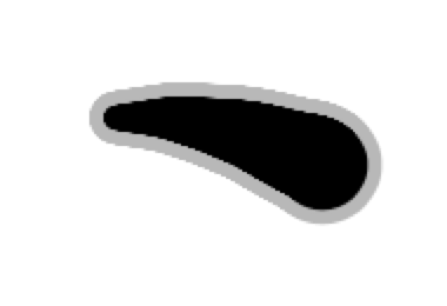

# World of Goo 光标 / World of Goo Cursor

把《粘粘世界》(World of Goo) 里那只黏黏球变成你的鼠标指针 —— 它跟着指针呼吸、拖尾、收缩，而真正的系统光标被隐藏。

支持 macOS 和 Windows。**本仓库只提供预编译二进制，不提供源码**，下载见 [Releases](https://github.com/ccrichard3/WoGCursormouse/releases)。

---

## 下载

| 平台 | 文件 | 说明 |
|---|---|---|
| macOS | `WorldOfGooCursor-1.0.0-macOS-arm64.zip` | 仅支持 Apple 芯片（M 系列）。Intel 机器不可用 |
| Windows | `WorldOfGooCursor-1.0.0-windows-x64.zip` | 需要 .NET Framework 4.8（Windows 10/11 自带） |

## 安装

### macOS

1. 解压 zip，得到 `WorldOfGooCursor.app`
2. 把它拖进「应用程序」文件夹
3. 双击运行

应用是菜单栏程序，没有 Dock 图标 —— 启动后看屏幕右上角菜单栏里的那个小球图标。

> **首次打开被系统拦住？**
> 这个应用是本地构建、ad-hoc 签名的，没有经过 Apple 公证，所以 Gatekeeper 会拦一次。两种解决办法：
> - 在「访达」里**右键点图标 → 打开 → 再点「打开」**；或者
> - 终端执行 `xattr -d com.apple.quarantine /Applications/WorldOfGooCursor.app`

### Windows

1. 解压 zip，得到 4 个文件：
   `World of Goo Cursor.exe`、`World of Goo Cursor.exe.config`、`WPFToolkit.Extended.dll`、`Settings.ini`
2. **这 4 个文件必须放在同一个文件夹里**，缺任何一个都跑不起来
3. 双击 `World of Goo Cursor.exe`

程序常驻托盘。左键单击托盘图标打开设置，右键单击打开菜单。

## 使用

- **菜单栏 / 托盘图标**：打开设置、暂停效果、隐藏系统光标、退出
- **设置窗口**：光标颜色、边框颜色、大小、拖尾长度、呼吸周期、刷新率等，实时预览
- **应用黑名单**：把某个应用加进去，它一处于活动状态，特效就会暂停并把系统指针还给你。
  默认已加入 **Bob**（截图工具）—— 它选中区域时需要一个能操作的界面和自己画的十字光标。
  这是应对「某个应用必须用自己的光标」的正确方式：macOS 会把一个应用的指针缓存到进程结束，
  任何光标表替换都到不了**已经开着**的应用，只有让特效让位才真正有效。
- **暂停效果**：完全停掉特效、交还指针

## 已知限制

- **macOS 上，应用自己画的光标无法被替换。** 终端的选字工字光标、某些应用的十字光标会照常显示。
  这是 macOS 的行为：应用只在第一次解析光标时读一次表，之后缓存到进程结束。属于系统限制，无法绕过 ——
  解决办法是把那个应用加进上面的黑名单。
- **Windows 上，如果进程被强制结束（任务管理器结束进程 / `taskkill /F`），光标可能保持隐藏。**
  重新启动一次程序即可自动恢复（程序启动时会重载系统光标方案）。正常退出不会有这个问题。
- macOS 版仅支持 Apple 芯片。

## 致谢 / Credits

- 特效创意与 **Windows 原版** by **Mygod** —— <https://github.com/Mygod/WoGCursor>
- 本仓库是独立的 macOS 移植，以及对 Windows 版的现代化改造（原生分层窗口、逐显示器 DPI、句柄与退出路径修复）
- 《World of Goo》是 2D Boy 的作品

## 说明

本仓库**仅分发预编译二进制文件**，不包含源代码。Windows 版基于 Mygod 的原版改造而来，
在此明确署名并链接上游，不对上游代码主张任何授权。

---

# English

The GEN-U-INE cursor of *World of Goo*, out of the game and onto your desktop: a breathing,
trailing blob follows your pointer while the real system cursor is hidden.

Prebuilt binaries for **macOS (Apple silicon)** and **Windows (.NET Framework 4.8)** are on the
[Releases](https://github.com/ccrichard3/WoGCursormouse/releases) page. This repository ships binaries only — no source.

- **macOS**: unzip, drag `WorldOfGooCursor.app` to Applications, open it. Menu-bar app.
  It is ad-hoc signed and not notarised, so right-click → Open the first time (or
  `xattr -d com.apple.quarantine`).
- **Windows**: unzip and keep all four files together, then run `World of Goo Cursor.exe`.

The effect and the original Windows build are by **Mygod** (<https://github.com/Mygod/WoGCursor>);
this repository is an independent macOS port plus a modernisation of the Windows build.
*World of Goo* is a 2D Boy property.
