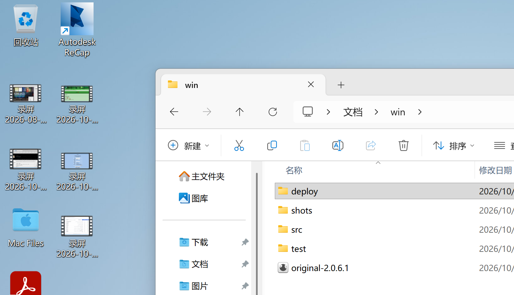
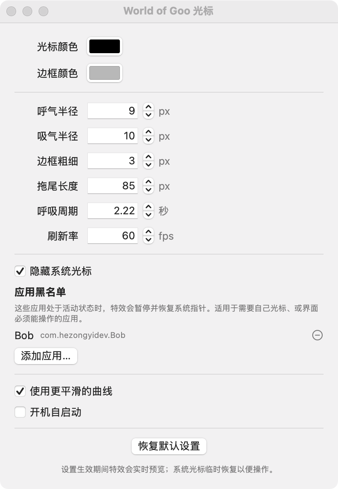

# World of Goo 光标 / World of Goo Cursor

把《粘粘世界》(World of Goo) 里那只黏黏球变成你的鼠标指针 —— 跟着指针呼吸、拖尾、收缩，真正的系统光标被隐藏。

支持 macOS 和 Windows。从 [Releases](https://github.com/ccrichard3/WoGCursormouse/releases) 即可下载最新版本。

## 效果

macOS：指针静止时，黏黏球安静地呼吸

Windows：快速拖动时，拖出一条长长的尾巴

设置界面：颜色、大小、拖尾长度、呼吸周期都可以调

## 安装

### macOS

1. 双击 dmg，把 `WorldOfGooCursor.app` 拖进「应用程序」文件夹
2. 开始享受吧

> **安装失败？**
> 这个应用是本地构建，无 Apple 签名，所以会拦截。
> - 终端执行 `xattr -d com.apple.quarantine /Applications/WorldOfGooCursor.app`

### Windows

1. 解压后把文件夹拖到任意位置，比如 `d:\`
2. 双击 `World of Goo Cursor.exe` 即可运行

## 设置选项

- **设置窗口**：光标颜色、边框颜色、大小、拖尾长度、呼吸周期、刷新率等，都可以调节
- **应用黑名单**：不想使用黏黏球的应用。默认已加入 **Bob**（截图工具）
- **暂停效果**：暂时停止

## 已知限制

- **macOS 上，应用自己画的光标无法被替换。** 终端的选字工字光标、某些应用的十字光标会照常显示。
  这是 macOS 的行为：应用只在第一次解析光标时读一次表，之后缓存到进程结束。属于系统限制，无法绕过 ——
  解决办法是把那个应用加进上面的黑名单。
- **Windows 上，如果进程被强制结束，光标可能保持隐藏。**
  重新启动一次程序即可自动恢复
- macOS 版仅支持 Apple 芯片。

## 致谢 / Credits

- 特效创意与 **Windows 原版** by **Mygod** —— <https://github.com/Mygod/WoGCursor>
- 本仓库是13年失效以后，独立的 macOS 重制版移植，以及对 Windows新版适配
- 《World of Goo》是 2D Boy 的作品

---

# English

The GEN-U-INE cursor of *World of Goo*, out of the game and onto your desktop: a breathing,
trailing blob follows your pointer while the real system cursor is hidden.

Prebuilt binaries for **macOS (Apple silicon)** and **Windows (.NET Framework 4.8)** are on the
[Releases](https://github.com/ccrichard3/WoGCursormouse/releases) page. This repository ships binaries only — no source.

- **macOS**: open the `.dmg`, drag `WorldOfGooCursor.app` to Applications, then launch it. Menu-bar app.
  It is ad-hoc signed and not notarised, so right-click → Open the first time (or
  `xattr -d com.apple.quarantine`).
- **Windows**: unzip and keep all four files together, then run `World of Goo Cursor.exe`.

The effect and the original Windows build are by **Mygod** (<https://github.com/Mygod/WoGCursor>);
this repository is an independent macOS port plus a modernisation of the Windows build.
*World of Goo* is a 2D Boy property.
